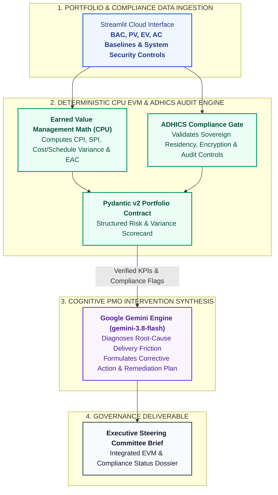

# Autonomous Digital Health Portfolio & ADHICS Sentry

> **Dataset & Confidentiality Note:** This application is an independent engineering architecture demonstration validated on representative, anonymized project datasets.

---

### Executive Problem Statement
Healthcare capital programs and hospital digital transformation initiatives require simultaneous governance across two distinct dimensions: **financial/schedule project controls** (Earned Value Management) and **strict sovereign health-data security regulations** such as the Abu Dhabi Healthcare Information and Cyber Security Standard (ADHICS). Tracking these in disconnected spreadsheets obscures budget slippage and compliance gaps until late-stage commissioning.

### Operational Value
* **Unified Cost & Schedule Visibility:** Deterministically computes Cost Performance Index (CPI), Schedule Performance Index (SPI), and Estimate at Completion (EAC) across multi-stream healthcare programs.
* **Proactive Regulatory Alignment:** Audits clinical system deployments against ADHICS data residency, access control, and encryption requirements prior to go-live.
* **Executive Steering Synthesis:** Translates raw EVM variances and compliance flags into actionable intervention briefs for program directors.

---

### System Architecture

---

### Core EVM Formulas Enforced on CPU
$$\text{CPI} = \frac{\text{EV}}{\text{AC}}, \quad \text{SPI} = \frac{\text{EV}}{\text{PV}}, \quad \text{EAC} = \frac{\text{BAC}}{\text{CPI}}$$

---

### Technology Stack
* **Runtime & UI:** Python 3.12, Streamlit Community Cloud
* **Validation & Analytics:** Pydantic v2, Pandas
* **Cognitive Synthesis:** Google GenAI SDK (`gemini-3.8-flash`)

### Author & Architect
**Rohit Kumar, PMP, CEng, CEA, FSEr (TÜV)**  
Cross-Technology Technical Architect | Mission-Critical Infrastructure & Applied AI Solutions  
[LinkedIn](https://www.linkedin.com/in/rohitg41) | [Live Application](https://rohit-kumar-health-sentry.streamlit.app)

---

### Enterprise Advisory & Custom Architecture
Available for technical consulting, custom agentic workflow development, and private enterprise deployments.  
**Connect:** [LinkedIn](https://www.linkedin.com/in/rohitg41) | **Email:** `grohit41@gmail.com`

---

### Intellectual Property & Licensing
**Copyright © 2026 Rohit Kumar. All Rights Reserved.**  
This repository and its source code are published solely for technical portfolio evaluation and architectural demonstration. Unauthorized copying, redistribution, or commercial deployment is prohibited without prior written consent.
